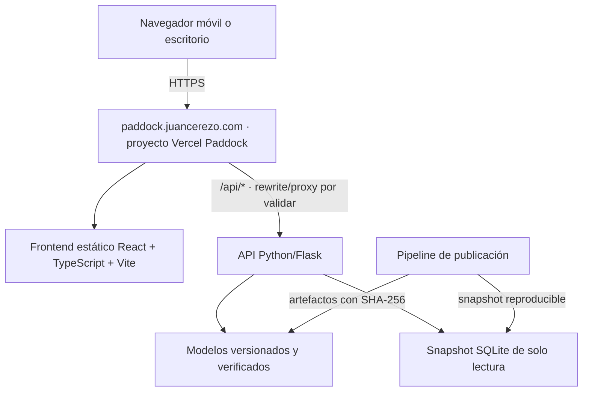

# Comprobación de arquitectura de Paddock

Fecha: 14-11-2026. Estado: comprobación local completada; cuenta, cuotas y DNS pendientes de verificación. La API candidata se implementó posteriormente, sin desplegar servicios. Este informe conserva las medidas de referencia históricas.

Avance de empaquetado: [función oficial de 115,50 MiB y pruebas locales completas](paquete-vercel.md), con modelos compactos, IDs auditados y SQLite. No equivale a una invocación real en Vercel ni a una confirmación de coste cero.

Actualización posterior: se ha evaluado un runtime compacto que conserva los bosques originales, sin reentrenar, y elimina las dependencias de ML de inferencia. Ver [evaluación del modelo](evaluacion-modelo.md) y [diagramas Archify](diagramas.md). Las medidas de sklearn en este informe son la línea base histórica; el candidato compacto usa unos 105 MiB en la prueba independiente.

Política actual: modelo y datos congelados por decisión del usuario, sin nuevos scrapings ni reentrenamiento. El [contrato de categorías y features](contrato-modelo-historico.md) queda auditado para integrar, con la procedencia exacta del entrenamiento aún no recuperada.

## Decisiones y alcance confirmado

- Migrar el frontend a React + TypeScript + Vite. Conservar Python/Flask inicialmente y preservar Flutter original en un tag histórico antes de modificar la aplicación.
- Publicar en un subdominio de `juancerezo.com`; propuesta `paddock.juancerezo.com`. El usuario confirma que gestiona el DNS en Vercel. El nombre exacto de subdominio y su disponibilidad deben verificarse antes de vincularlo.
- Preferir la cuenta existente y un proyecto Vercel independiente del portfolio, sujeto a comprobar acceso y configuración. El dominio raíz del portfolio debe seguir funcionando sin cambios.
- Presupuesto posteriormente confirmado: 0 € de servicios adicionales en Vercel; el único pago será el dominio existente. No hay autorización para contratar servicios de pago. La viabilidad de API/modelos en ese presupuesto sigue pendiente de validar. Ver [costes y diagramas](costes-y-diagramas.md).

## Arquitectura candidata

La opción de producción a comprobar es Vercel Functions dentro del presupuesto cero. Los contenedores externos comparados más abajo quedan como referencia técnica fuera del alcance autorizado, tras confirmar el usuario que quiere mantenerse gratis en Vercel. El almacenamiento de modelos no proporciona cómputo para ejecutarlos. En esta variante las peticiones del navegador no deben descargar el modelo ni conocer credenciales de almacenamiento.

El proxy `/api/*` permitiría un solo origen público y evitaría añadir otro subdominio por defecto; falta verificar límites de proxy y tiempos del proveedor. La API debe seguir protegida frente a abuso aunque no se enlace su URL directa. Los rewrites de API tienen que resolverse antes del fallback de la SPA.

## Qué hace falta ejecutar

| Componente | Necesidad comprobada | Propuesta |
| --- | --- | --- |
| Frontend | Formulario, predicción, gráficos/tablas, chat y filtros | Build estático Vite; sin Firebase por defecto |
| API | Clasificación, inferencia de precio y consultas de coches | Flask con servidor de producción; contrato validado |
| Modelo de precio | RandomForestRegressor, 100 árboles, 9 features | Un artefacto confiable por versión, cargado una vez por proceso |
| Clasificador | RandomForestClassifier, 100 árboles, vocabulario de 539 features | Conservar tokenizer y vectorizador compatibles |
| Datos | Agregaciones y consultas sobre catálogo histórico | Snapshot SQLite de solo lectura, pendiente de adapter y pruebas completas |
| Lógica del chat | Extracción de marcas/modelos/filtros hoy implementada en Dart | Portar explícitamente; el clasificador Python no la sustituye |
| Autenticación de usuarios | No se ha identificado una función que la necesite | No introducir cuentas ni proveedor de identidad por defecto |
| Entrenamiento | Proceso distinto de servir peticiones | Ejecutarlo fuera del runtime público y publicar resultados versionados |

No se ha identificado necesidad de Redis, colas, entrenamiento online, SSR o una base de datos de escritura para los recorridos actuales. El control de abuso distribuido se resolverá con las capacidades verificadas del proveedor o un componente específico si fuese necesario.

## Pruebas y recursos medidos

Pruebas realizadas sobre el código original, usando Python 3.10.22, scikit-learn 1.2.1, NumPy 1.24.4 y SciPy 1.10.1. Scripts y resultados de diagnóstico están fuera del checkout, en `/tmp/paddock-architecture-probe.py` y `/workspace/.paddock/research/architecture-probe.json`. No son pruebas de capacidad de Vercel ni del futuro runtime actualizado.

| Medida | Resultado local | Implicación |
| --- | --- | --- |
| Modelo de coches en disco | 98.446.358 bytes, 93,88 MiB | El archivo comprimido no representa su RAM |
| Serialización de coches descomprimida | 473.048.993 bytes, unos 451 MiB | La carga necesita memoria adicional transitoria |
| Estructura del bosque | 7.390.896 nodos en 100 árboles | La complejidad del modelo explica buena parte del consumo |
| Modelo de mensajes en disco | 498.848 bytes, 0,48 MiB | Su almacenamiento es pequeño frente al regresor |
| Importación Flask y carga de modelos | 5,16 s y 6,89 s en dos procesos | Medida con filesystem local ya disponible; falta arranque frío real del proveedor |
| Pico de RAM durante importación/carga | 1.017,59 MiB y 1.016,66 MiB | Un límite de 1 GiB dejaría margen insuficiente para servir peticiones |
| RAM residente tras cargar, segunda medición | 636.196 KiB, unos 621 MiB | Punto de partida; falta medir concurrencia y runtime de producción |
| Inferencia de precio, 50 repeticiones | Mediana 5,24 ms; p95 6,84 ms | Latencia del estimador únicamente, no calidad ni tiempo HTTP completo |
| Clasificación de texto, 50 repeticiones | Mediana 6,24 ms; p95 8,00 ms | Incluye vectorización local; no red ni arranque frío |
| Dependencias instaladas sin pycache | 207.484.441 bytes, unos 198 MiB | El bundle real debe medirse con el empaquetador del proveedor |
| Dependencias + ambos modelos + SQLite candidato | Aproximadamente 312 MiB | Estimación local, sin runtime Python; no usarla como tamaño final del despliegue |

Como referencia de capacidad del runtime histórico, para probar un contenedor con este modelo se partiría de 2 GiB de RAM y un solo worker de inferencia. No es una elección de producción ni autorización de coste: la solución autorizada debe mantenerse en Vercel a coste cero. Multiplicar workers puede multiplicar memoria. La conversión compacta ya medida reduce recursos conservando el mismo bosque; no se reentrenará.

La inferencia se ejecutó con valores extraídos del CSV como prueba de cómputo. Debido a la incompatibilidad de diccionarios que se detalla abajo, estas mediciones NO validan la interpretación o precisión de la predicción.

## Datos: SQLite permite estudiar una opción sin MongoDB

- `datasets/car_data.csv`: 179.502 filas y 45.262.510 bytes.
- `datasets/ML/cars_ml.csv`: 179.502 filas y 25.430.473 bytes.
- `datasets/ChatBOT/message_data.csv`: 357 filas; hay que revisar cobertura y reproducibilidad del entrenamiento.
- Un prototipo desechable proyectó las 11 columnas utilizadas por las consultas de la API a SQLite. Conversión de año, potencia, kilometraje, precio, cilindrada y marchas: cero filas con números inválidos en esta prueba.
- Importación e índices: 2,28 s. Archivo: 20.733.952 bytes, unos 19,77 MiB.
- Verificados: total de filas, conteo por marca/año contra el CSV y mínimo/máximo por modelo/rango de precio contra el CSV.
- Consulta indexada de rango de precios: mediana 0,092 ms, p95 0,147 ms, 50 repeticiones. Muestra aleatoria de 10 filas: mediana 16,27 ms, p95 18,57 ms, 10 repeticiones.
- El archivo de prueba se eliminó al finalizar. No se ha implementado ningún adapter ni sustituido MongoDB en la aplicación.

Conclusión: SQLite es una alternativa local viable para este catálogo estático y evita depender de recuperar MongoDB para empezar. Antes de elegirla definitivamente hay que validar todas las consultas y su semántica, resultados vacíos, textos/acentos, ordenación, muestreo y límites. No es una equivalencia completa de MongoDB ya demostrada. Un catálogo con nuevas escrituras o datos vivos requeriría revisar esta decisión.

## Bloqueo de integridad entre modelo, datos y diccionarios

La comprobación completa de las 179.502 filas detectó:

| Diccionario | Entradas | Coincidencias exactas entre modelo_id y modelo del CSV | Filas con ID ausente |
| --- | --- | --- | --- |
| `diccionarios/dic_cars_modelo.json` | 719 | 179.502 | 0 |
| `padook/Backend/dictionary/dic_cars_modelo.json` | 542 | 0 | 47.869 |
| `padook/Frontend/assets/json/dic_cars_modelo.json` | 542 | 0 | 47.869 |

Ejemplo: el ID 118 del CSV es `Citroen C3 aircross`; en el diccionario de la aplicación es `Dodge Journey`. Los IDs numéricos del CSV además aparecen como decimales, por lo que se normalizaron a enteros para comparar.

El diccionario de la aplicación sí coincide exactamente con `diccionarios/dic_cars_modelo_less.json` (542 entradas). El notebook de entrenamiento exporta varios bosques distintos, uno por variante de dataframe (`Sklearn_RF_{df}.pkl`), mientras que la aplicación conserva el nombre genérico `cars_model.pkl`. Falta identificar a cuál corresponde ese archivo.

La auditoría posterior confirmó cortes del bosque hasta `model_id=717.5`, ocho combustibles en CSV/notebook y tres IDs desplazados en el selector de combustible. Se ha reconstruido un contrato coherente con esas evidencias y una traducción explícita del selector antiguo; deben integrarse antes de publicar predicciones. La población exacta del entrenamiento no se ha recuperado y queda documentada, sin reentrenar ni cambiar el bosque.

## Almacenamiento y ejecución en Vercel

No se pueden confirmar aún cuotas gratuitas o precios vigentes. Las páginas oficiales devolvieron `CONNECT tunnel failed: 403 Forbidden` desde el proxy del entorno:

- https://vercel.com/docs/vercel-blob/usage-and-pricing
- https://vercel.com/docs/functions/limitations
- https://vercel.com/docs/plans/hobby

| Variante | Ventaja | Comprobación necesaria |
| --- | --- | --- |
| Functions con artefactos incluidos | Evita descargas de modelos al arrancar | Bundle Python final, RAM, CPU, timeout, disco temporal y concurrencia del plan |
| Functions + Blob | Reduce lo incluido en el bundle | Mismos límites de ejecución, descarga en arranque, caché por instancia, permisos, cuotas y coste de transferencia |
| Frontend Vercel + API en contenedor con artefactos incluidos | Runtime controlable y artefactos ya presentes | Precio, RAM, suspensión por inactividad, arranque, región y proxy `/api` |
| Contenedor + almacenamiento externo de artefactos | Permite versionar modelos por separado | Complejidad adicional, transferencia, integridad y coste; justificar frente a incluirlos en la imagen |

Los dos modelos suman unos 94,36 MiB. Si se descargan una vez por instancia nueva, 1.000 arranques equivalen a unos 92,15 GiB de transferencia solo de modelos. Esto es un cálculo de volumen, no una previsión de visitas ni una tarifa de Vercel. Una visita no equivale necesariamente a un arranque. Descargar en cada petición sería una mala base de arquitectura.

Para una demo estática, la opción más sencilla a evaluar primero es incluir snapshot y modelos en el runtime/imagen cuando los límites lo permitan: podría no hacer falta contratar almacenamiento de objetos separado. Blob se elegirá si aporta una ventaja comprobada. Si se usa, las credenciales quedan en backend y cada descarga se verifica contra un manifiesto de hashes confiable.

Hashes de referencia:

- `cars_model.pkl`: `1c36a9dca5b7ac0076d6fef0f1c6db9952aba5b42fae92db647b1f4750a11b87`.
- `message_model.pkl`: `d56b8604ad35cd4815ec0ec3c3b706a715ee7fbe736d8e55b281786d791ee58d`.

## Dominio, cuenta y acceso

- El usuario confirma DNS en Vercel. No hay evidencia de consulta a su cuenta todavía.
- La búsqueda de herramientas disponibles en esta sesión no expone conector Vercel. No se puede instalar mediante el mecanismo actual porque Vercel no figura entre los plugins recomendados disponibles. No se ha solicitado ningún token.
- Las consultas HTTPS a `juancerezo.com` y `paddock.juancerezo.com` devolvieron 403 del proxy. La resolución DNS nativa tampoco estuvo disponible. Esto NO prueba que el dominio falle, que el subdominio esté libre ni que Vercel esté mal configurado.
- Se guardaron en el borrador los destinos `vercel.com`, `juancerezo.com`, `paddock.juancerezo.com` y `dns.google`, preservando `storage.googleapis.com` y los presets existentes. No se ha aplicado ni publicado esa configuración.
- Para inspeccionar la cuenta, habilitar el conector Vercel en esta sesión si el producto lo permite. Para investigar documentación y DNS público, aplicar las reglas de red del borrador. Son accesos diferentes: permitir una web no autoriza el acceso privado a la cuenta.

Cuando haya acceso, consultar en modo lectura: equipo/cuenta, plan y consumo compartido, proyectos del portfolio, zona `juancerezo.com`, registros existentes, si `paddock` ya está ocupado, asociación de dominios, certificados y región de cómputo. No leer ni volcar valores secretos.

Después de validar una preview, añadir solo la asociación y el registro que Vercel indique para el subdominio. No modificar NS, apex, `www`, correo ni el proyecto del portfolio por defecto. No fijar un CNAME genérico antes de conocer las instrucciones del proveedor para este proyecto. Mantener despliegue desde Git y rollback de una versión segura.

## Resultado y siguiente puerta de decisión

Comprobado localmente: ejecución de modelos históricos; tamaños, memoria y latencia aproximados; catálogo completo consultable en una prueba SQLite; y una incompatibilidad de diccionarios que debe resolverse. Stack React acordado y dominio propuesto documentado. Node 24.22.1/npm 11.9.0 presentes, sin proyecto nuevo generado.

Pendiente antes de implementar:

1. Habilitar acceso de lectura a Vercel y aplicar los destinos de red para verificar documentación/DNS. Confirmar plan, cuotas y uso actual de la cuenta.
2. Comprobar Functions dentro de Vercel con presupuesto adicional obligatorio de 0 €. No hay aún una opción gratuita demostrada para la API/modelo completo. Si no cabe, estudiar compactación validada del modelo antes de cambiar arquitectura; quedan descartados servicios de pago.
3. Aplicar el contrato de IDs auditado y conservar explícita la incertidumbre de procedencia. Mantener modelo y snapshot histórico congelados, sin reentrenar, y advertir de la fecha de los datos al usuario final.
4. Redactar la decisión final de alojamiento y los contratos de API/datos. El cierre de capacidad en el proveedor requerirá una prueba de preview, que se realizará en la fase técnica correspondiente, antes de producción.
5. Preservar el original con el tag y comenzar entonces la implementación por fases del plan.

No hay componentes React, reentrenamiento, cambios DNS ni issue del portfolio. Posteriormente se añadió la API candidata con sus propias dependencias fijadas y un tag local del original; la aplicación y dependencias históricas permanecen intactas. No se han publicado tags remotos ni servicios.
