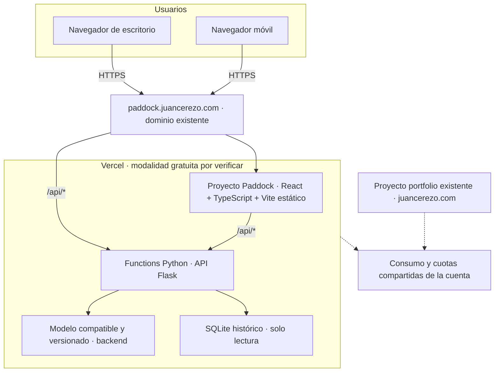
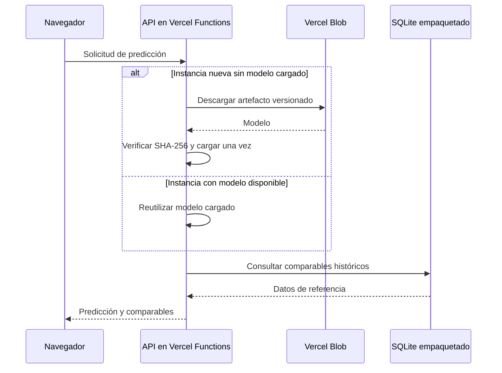
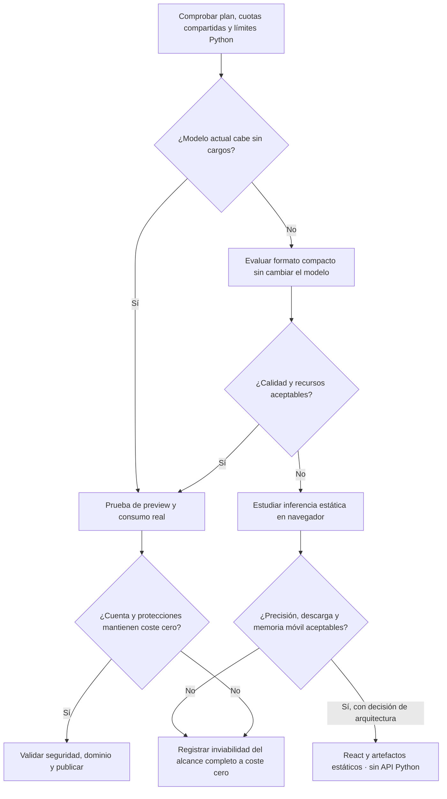

# Paddock: presupuesto cero y diagramas de arquitectura

Fecha: 14-11-2026. Requisito del usuario: permanecer en Vercel sin pagar servicios adicionales; únicamente pagar el dominio que ya tiene.

**Estado al 17-11-2026:** [aplicación pública verificada](https://paddock.juancerezo.com), [release `v2026.11.17`](https://github.com/Legodark/paddock/releases/tag/v2026.11.17), Hobby activo y sin servicios adicionales de pago. Modelo compacto y SQLite empaquetados en Functions, sin Blob ni base gestionada. [Evidencia de entrega](entrega-publica-20261117.md). El saldo mensual compartido de CPU/RAM sigue desconocido; esta publicación no certifica capacidad o continuidad ilimitadas.

Política posterior confirmada: modelo y datos congelados, sin scraping nuevo ni reentrenamiento. El [contrato reconstruido](contrato-modelo-historico.md) corrige la traducción de las entradas sin modificar los árboles.

## Estado de los diagramas y fuentes

Se ha localizado [Archify en GitHub](https://github.com/tt-a1i/archify) y se han generado [tres diagramas interactivos](diagramas.md) ejecutando su habilidad desde una copia local. Los cuatro gates originales, incluido el navegador, ya pasaron en GitHub Actions y los HTML se revisaron en claro/oscuro. Se conservan los bytes de la propuesta del 14-11-2026 y los diagnósticos locales anteriores. Los Mermaid siguientes se conservan como esquemas textuales complementarios.

Actualización tras publicar el entorno: la documentación oficial es accesible y la CLI está autenticada. Se confirmó el equipo `legodarks-projects` en Hobby activo y el dominio `juancerezo.com` verificado, asociado al portfolio. Las herramientas del conector no aparecen en esta sesión; se utilizaron consultas CLI de solo lectura.

Fuentes oficiales consultadas; revisar de nuevo sus condiciones antes de publicar:

- [Vercel Hobby](https://vercel.com/docs/plans/hobby): elegibilidad, recursos incluidos, uso compartido y comportamiento al superar límites.
- [Límites de Functions](https://vercel.com/docs/functions/limitations): Python, bundle, memoria, CPU, duración y disco temporal.
- [Uso y precios de Blob](https://vercel.com/docs/vercel-blob/usage-and-pricing): almacenamiento, operaciones, transferencia y comportamiento al agotar la cuota.

## Revisión de coste y capacidad · 17-11-2026

La [revisión oficial actualizada](evidence/preview/hobby-cost-boundary-20261117.json) distingue dos conclusiones:

- **Coste adicional previsto: 0 €**, manteniendo Hobby y sus funciones incluidas, sin activar extras de pago. Functions muestra cuotas incluidas en Hobby y consumo on-demand en Pro. No es necesario contratar Observability Plus para verificar que el plan es gratuito.
- **Capacidad y continuidad: no certificadas.** CPU/RAM facturados, frío real y saldo mensual compartido permanecen desconocidos. Una consulta mensual de agregados del firewall también devuelve «Observability Plus is required for this query»; no se compra ni se repite esa consulta como si fuera gratuita. Los agregados que sí funcionaron en ventanas cortas no sustituyen el saldo mensual.

Hobby no ofrece Spend Management configurable (N/A); las notificaciones automáticas de uso no son un límite de gasto. No se afirma haber configurado un presupuesto automático de cero euros.

Al agotar compute puede pausarse todo el equipo, incluido el portfolio, con `503 DEPLOYMENT_PAUSED`. La documentación no promete reanudación automática tras 30 días y contempla contactar Support. Para el millón WAF incluido no se ha localizado una especificación de agotamiento que permita prometer fail-closed o protección indefinida.

El escritorio figura habilitado, pero no hay herramienta de control del navegador o apertura de visor expuesta; tampoco hay display o proceso de navegador en la máquina comprobada. No se ha podido leer Usage mediante una sesión gráfica ni se han extraído cookies/credenciales. Esta limitación de observación no se convierte en saldo completo.

Las secciones siguientes conservan cuotas y mediciones históricas con su fecha. La app ya está publicada en su subdominio y mantiene la regla activa; las referencias del 15-11 a proyecto/regla aún no creados describen aquella fase, no el estado actual.

## Cuotas y margen conocido

El plan Hobby consultado incluye los siguientes recursos. Son cuotas compartidas del equipo; los consumos proceden de las capturas aportadas por el usuario para los últimos 30 días, del 15 de octubre al 14 de noviembre. No se han inferido a partir del panel de las últimas 12 horas.

| Recurso | Incluido en Hobby | Consumo aportado | Proporción aproximada |
| --- | ---: | ---: | ---: |
| Fast Data Transfer | 100 GB/mes | 20,89 MB | 0,021 % |
| Fast Origin Transfer | 10 GB/mes | 197,39 kB | 0,002 % |
| CDN Requests | 1 millón/mes | 2,4 K | 0,24 % |
| Active CPU | 4 horas/mes | No disponible | Sin estimar |
| Provisioned Memory | 360 GB-h/mes | No disponible | Sin estimar |
| Function Invocations | 1 millón/mes | No disponible | Sin estimar |

Functions Python admite un bundle de hasta 500 MB según la documentación consultada. Con Fluid compute, Hobby usa un máximo de 2 GB de memoria y una CPU; la memoria asignada predeterminada es 2 GB. Los **126 MiB de RSS locales no equivalen a 126 MiB facturados**: el cálculo de memoria provisionada usa la memoria asignada y su tiempo facturable. Por ejemplo, 360 GB-h / 2 GB son 180 horas agregadas teóricas, antes de descontar otros proyectos y sin garantizar una capacidad de peticiones.

No se pudo recuperar el consumo mensual de compute con las consultas gratuitas probadas. La API de métricas requiere Observability Plus y no se contratará. «Sin suscripción» en la API de facturación no significa consumo cero. La consulta se repitió el 15-11-2026 con el mismo resultado; ver [revisión actual y evidencia de cuenta](revision-pr-y-hobby.md). Esta incertidumbre no bloquea la implementación y pruebas locales, que no consumen Functions del equipo.

La documentación de Functions advierte además que, al pausarse un equipo Hobby por cuota, pueden quedar pausados **todos sus despliegues** y la reactivación puede necesitar una acción del propietario o soporte. No se garantiza recuperación automática al pasar 30 días. Crear Paddock como proyecto separado no aísla al portfolio de ese riesgo compartido. La [prueba inicial propuesta](revision-pr-y-hobby.md#condiciones-de-la-siguiente-prueba) limita solicitudes y conserva esta incertidumbre explícita.

**Coste incremental previsto de la arquitectura elegida: 0 €/mes dentro de Hobby y sus límites.** No se necesita Blob: el modelo compacto y SQLite ya caben en la función. No se ha contratado almacenamiento, base gestionada ni plan de pago; el proyecto Paddock funciona en Hobby. El coste de renovación del dominio sigue siendo el actual del usuario. La comprobación final acreditó predicción, clasificación y búsqueda en el subdominio real, conservando Hobby sin extras; el margen de compute compartido no está certificado.

## Presupuesto exigido

Esta tabla define el presupuesto permitido; no constituye una confirmación del proveedor ni una estimación de que el modelo actual ya encaje.

| Partida | Incremento mensual máximo | Condición de aceptación |
| --- | ---: | --- |
| Frontend React/Vite en Vercel | 0 € | Proyecto en modalidad gratuita elegible y consumo dentro de sus límites |
| API e inferencia en Functions | 0 € | Modelo, runtime, RAM, CPU e invocaciones admitidos por el plan gratuito verificado |
| Catálogo histórico SQLite | 0 € | Archivo empaquetado; sin base gestionada contratada; respetar tamaño del despliegue |
| Modelos empaquetados | 0 € | Caben en el bundle y se sirven únicamente en backend, sin almacenamiento adicional |
| Vercel Blob, si resulta necesario | 0 € | Cuota incluida suficiente y ausencia de cobro adicional garantizada por configuración/condiciones verificadas; si no, no se activa |
| DNS y asociación del subdominio | 0 € adicional previsto | Usar el dominio existente; confirmar que la asociación está incluida en la cuenta |
| Monitorización y protección frente a abuso | 0 € | Capacidades gratuitas verificadas, sin activar extras de pago |
| Renovación de `juancerezo.com` | Importe actual del usuario | Gasto existente, no cotizado ni modificado en esta tarea |
| **Servicios nuevos en total** | **0 €** | **Todas las condiciones anteriores deben cumplirse** |

Actualización 15-11-2026: el [firewall de Hobby](proteccion-vercel.md) incluye una regla de rate limiting por proyecto y el primer millón de solicitudes permitidas al mes. La propuesta local protege `/api` con 60 solicitudes/minuto por IP, sin KV/Redis ni servicios nuevos. La CLI confirmó que el equipo sigue en Hobby y que Paddock todavía no existe como proyecto; la regla no se ha aplicado. Se mantienen pendientes su enforcement y el comportamiento específico al agotar el tramo incluido. La [CI](../ci/README.md) pasó localmente y en GitHub; no invoca Functions de Vercel.

No hay presupuesto para Vercel Pro, ampliaciones de Blob, planes con pago por uso sin límite duro, contenedores de pago, bases gestionadas de pago o servicios externos adicionales. No introducir una tarjeta ni aceptar un trial que se convierta en pago como parte de esta solución.

Crear otro proyecto no significa disponer de una bolsa independiente de recursos gratis: verificar cómo se comparten las cuotas con el portfolio y el resto de la cuenta. El consumo existente debe descontarse antes de estimar capacidad para Paddock.

## Diagrama 1: opción preferente a comprobar

Objetivo: evitar otro proveedor, una base gestionada y almacenamiento de objetos separado. El constructor oficial ya generó una función de 115,50 MiB con ambos modelos y SQLite. El funcionamiento en la plataforma se verificó después en la [entrega pública](entrega-publica-20261117.md); el consumo real y el margen mensual no se deducen del tamaño del `.pkl` y siguen sin medirse.

## Diagrama 2: variante con Blob, solo si no añade coste

El acceso a Blob y sus credenciales, si se necesitan, pertenecen al backend. La caché por proceso no es persistente ni compartida entre instancias. Blob puede reducir el bundle, pero no reduce por sí solo el pico de RAM del modelo ni elimina coste/consumo de arranques.

## Consumo medido y sensibilidad

Actualización: la [evaluación compacta](evaluacion-modelo.md) reduce ambos modelos a 22,63 MiB comprimidos y ejecuta la inferencia sin dependencias ML con unos 105 MiB de RAM en la prueba independiente. Binario descomprimido, chat y SQLite suman unos 111,45 MiB antes de Flask/runtime y empaquetado. La opción preferente a comprobar es incluirlos en Functions, sin Blob. El bloque siguiente conserva la línea base histórica para comparar; no describe el nuevo runtime compacto.

Comprobación posterior: el [builder oficial generó una función completa de 115,50 MiB](paquete-vercel.md). La API candidata con HTTP local y dependencias Flask usó unos 126,1 MiB de RAM. Cuenta y plan están confirmados; quedan el consumo compartido de compute, protección contra abuso y validación real en Vercel. El presupuesto permitido continúa siendo 0 € adicionales.

Resultados locales detallados en [arquitectura-reactivacion.md](arquitectura-reactivacion.md):

- Ambos modelos: 94,36 MiB de archivos.
- Modelo de precio descomprimido: unos 451 MiB de serialización.
- Proceso con modelos cargados: unos 621 MiB residentes; pico de carga de unos 1.018 MiB.
- Dependencias instaladas sin pycache + modelos + SQLite candidato: unos 312 MiB; el bundle final del proveedor todavía no se ha medido.
- Snapshot SQLite candidato: unos 19,77 MiB para 179.502 coches.

Si ambos modelos se descargan al crear cada instancia, este es el volumen acumulado, sin incluir respuestas de API, frontend ni operaciones de almacenamiento:

| Instancias nuevas que descargan los modelos | Transferencia aproximada de modelos |
| ---: | ---: |
| 1 | 94,36 MiB |
| 10 | 0,92 GiB |
| 100 | 9,21 GiB |
| 1.000 | 92,15 GiB |

Son cálculos sobre bytes medidos, no cuotas de Blob ni una previsión de tráfico. No convertirlos en euros sin tarifas verificadas. El número de instancias depende del runtime, concurrencia y patrón de tráfico; no equivale al número de usuarios.

Para dimensionar la cuenta, registrar: tamaño del frontend por primera visita, visitas mensuales previstas, llamadas por recorrido, tiempo facturado por petición, arranques con/sin caché, descargas de modelos y almacenamiento de versiones. No usar los milisegundos de inferencia local como duración facturada: faltan red, carga, consultas y semántica de facturación del proveedor.

Con cuotas verificadas, calcular por recurso `margen disponible = incluido en la cuenta − consumo actual del portfolio y otros proyectos`. La solución solo se acepta si el consumo previsto y un margen de prueba caben sin cargos. No fijar ahora una cifra de visitas admitidas sin esos datos.

## Si el modelo actual no cabe gratis

Orden de evaluación:

1. Modelo y SQLite incluidos en Functions, si los límites gratuitos vigentes lo permiten.
2. Formato compacto ya evaluado en Python: conservar todos los árboles, umbrales y hojas, con los IDs originales auditados. Comprobar equivalencia y recursos en el proveedor. No reentrenar, podar ni sustituir el modelo para hacerlo encajar.
3. Solo como decisión de arquitectura alternativa: inferencia en navegador con un artefacto suficientemente pequeño, formato compatible y consultas estáticas/WASM u otra estructura local validada. Esto cambia dónde se ejecuta el modelo y qué datos/modelos se entregan al visitante; requiere validación móvil, de exposición de artefactos y de transferencia. No está implementado ni aprobado como sustituto automático de Flask. No enviar el modelo actual de 94 MiB y el catálogo completo al móvil sin esa evaluación.
4. Si ninguna alternativa supera calidad, recursos y cuotas, documentar que la aplicación completa no es viable bajo estas condiciones. No desplegar un servicio con coste, ocultar funciones rotas o sustituir el modelo por respuestas prefabricadas.

## Condiciones antes de publicar

- Comprobar plan real, elegibilidad y cuotas incluidas, con fecha y fuente; contrastarlas con el consumo actual de la cuenta.
- Mantener desactivadas compras, upgrades y funcionalidades facturables; comprobar qué ocurre al superar cada cuota. No afirmar que una alerta equivale a un límite de gasto.
- Aceptar que, con presupuesto rígido de cero, la aplicación podría necesitar limitar peticiones o quedar temporalmente indisponible al agotarse el servicio incluido. El comportamiento real debe verificarse en las condiciones del plan; no se garantiza disponibilidad ilimitada.
- Limitar entradas, resultados y frecuencia de consultas; no permitir entrenamiento, descarga arbitraria de artefactos o consultas sin límite desde la API pública.
- Probar arranque sin caché, carga completa, concurrencia acotada y recuperación en preview antes de asociar el subdominio.
- Resolver primero el desacuerdo de IDs entre diccionarios y datasets. Una predicción rápida o barata con categorías incorrectas no valida la aplicación.
- Consultar el registro DNS y la asociación que Vercel indique para `paddock.juancerezo.com`; no tocar los registros del portfolio.

## Pendiente externo y siguiente paso

El presupuesto está cerrado: **0 € adicionales**. Las cuotas oficiales, la cuenta Hobby activa y el tamaño del paquete están comprobados; la capacidad mensual y la disponibilidad real siguen pendientes de compute compartido y prueba de plataforma. Se usa la CLI autenticada porque el conector no está expuesto en esta sesión. Los diagramas de Archify ya están validados y revisados visualmente; no acreditan un despliegue real de la aplicación.

La red necesaria ya está aplicada. No se han contratado servicios, activado Blob, publicado previews ni modificado DNS durante esta fase. La [revisión de las issues #8/#9](revision-pr-y-hobby.md) registra las fuentes, el barrido de historial, las licencias y el procedimiento previo a preview.
